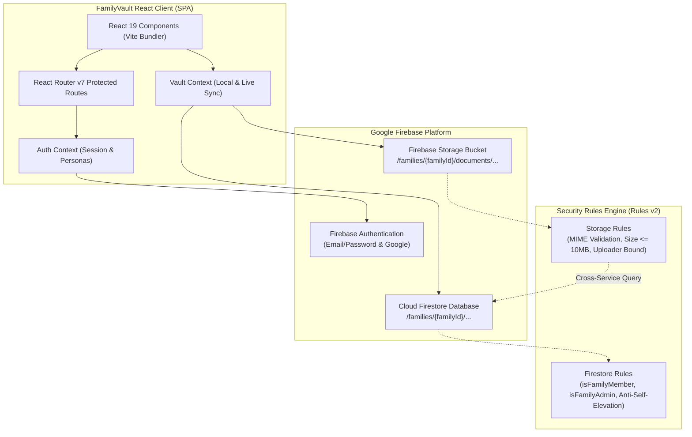

# FamilyVault – Secure Multi-Family Document Management System

[](https://react.dev/)
[](https://vitejs.dev/)
[](https://firebase.google.com/)
[-10B981?logo=shield&logoColor=white)](#-security-architecture--audit-results)
[](LICENSE)
[](https://github.com/santhoshm6263/FAMILY-VAULT)

**FamilyVault** is a production-ready, security-audited web application built for managing family identity documents (Aadhaar, PAN, Passport, Voter ID, Driving License, Health Insurance) across completely isolated family workspaces with granular role-based access control, dual-sided card inspection, and live cloud storage integration.

---

## 📑 Table of Contents
- [Project Overview](#-project-overview)
- [Key Features](#-key-features)
- [Technology Stack](#-technology-stack)
- [Architecture Diagram](#-architecture-diagram)
- [Security Architecture & Audit Results](#-security-architecture--audit-results)
- [Firebase Setup Guide](#-firebase-setup-guide)
- [Environment Configuration](#-environment-configuration)
- [Installation & Local Development](#-installation--local-development)
- [Deployment Instructions (Firebase Hosting)](#-deployment-instructions-firebase-hosting)
- [Screenshots & UI Walkthrough](#-screenshots--ui-walkthrough)
- [Future Improvements](#-future-improvements)

---

## 🌟 Project Overview

Managing confidential family identity documents often relies on unencrypted messaging apps or shared cloud drives that mix family members' records without permission controls. 

**FamilyVault** solves this by providing:
1. **Multi-Family Isolation:** Multiple independent families use the same platform while strictly confined to their private workspace boundaries.
2. **Dual-Sided Identity Inspection:** Specialized handling for Indian and international documents with front and back side uploads, numbers masking, and native PDF/image preview.
3. **Role-Based Access Control (RBAC):** Strict hierarchy enforcing **Owner**, **Admin**, and **Member** permissions on both client and database levels.
4. **Resilient Local Persistence & Hybrid Mode:** Operates with full offline demo datasets for evaluation and seamlessly connects to live Firebase services when environment variables are configured.

---

## ✨ Key Features

- **Multi-Family Cloud Firestore Architecture:**
  - Dynamic family workspace creation with auto-generated vault codes (`FV-8842-SH`).
  - Family membership rosters with role-based member assignments.
  - Invitation engine supporting email invites with fast lookup codes (`FV-INV-4921`).
  - Support for dependents and minor family members without email accounts.

- **Firebase Storage Document Management:**
  - Dual-sided uploads (**Front** and **Back**) for PDF, PNG, JPG, and JPEG files up to 10MB.
  - Resumable live upload progress tracking (0%–100%).
  - Built-in **"Use Synthetic Sample"** presets for testing without uploading sensitive personal documents.
  - Document file replacement with automatic cleanup of replaced storage objects.
  - Authorized in-browser document downloads via authenticated fetch blobs.

- **Authentication & Account Security:**
  - Email and password registration with automatic verification email delivery.
  - Google Authentication via Firebase Auth popup.
  - Password recovery workflow.
  - Session restoration and persistence across browser reloads.
  - Protected route guards enforcing authenticated and verified sessions.

- **Modern SaaS Dashboard & Document Browser:**
  - Live metric stat cards (Total Members, Active Documents, Storage Quota).
  - Categorized identity document browser (Aadhaar, PAN, Passport, Voter ID, Driving License, Other).
  - Search across titles, numbers, notes, and tags.
  - Switch between visual card preview grid and dense tabular list view.
  - Masked number toggle for privacy protection (`•••• •••• 3847` vs `5482 9102 3847`).

---

## 🛠️ Technology Stack

| Layer | Technology | Purpose |
| :--- | :--- | :--- |
| **Frontend Framework** | **React.js 19** | Component architecture, state hooks, and virtual DOM |
| **Build Tool** | **Vite 8** | High-speed ESM dev server and optimized Rollup production bundler |
| **Routing** | **React Router v7** | Client-side routing, protected routes, URL search sync |
| **Authentication** | **Firebase Auth** | Email/password, Google provider, email verification |
| **Database** | **Cloud Firestore** | Document database with multi-tenant subcollections |
| **File Storage** | **Firebase Storage** | Resumable binary storage for PDFs, PNGs, and JPEGs |
| **Security Rules** | **Firestore & Storage Rules v2** | Server-side role verification, cross-tenant isolation, MIME validation |
| **Design System** | **Custom Modern SaaS CSS** | Responsive slate design system, zero bloated UI libraries |
| **Icons** | **Lucide React** | Clean, accessible SVG iconography |
| **Testing** | **Node.js ESM Test Suite** | 36-point security rule audit and validation engine |

---

## 🏗️ Architecture Diagram



---

## 🛡️ Security Architecture & Audit Results

FamilyVault was subjected to a comprehensive Phase 5 security audit across all 5 critical attack scenarios. All **36 / 36 automated assertions passed (100%)**.

### Role Permissions Matrix

| Permission / Action | Owner | Admin | Member | Unauthenticated |
| :--- | :---: | :---: | :---: | :---: |
| **View Family Documents & Members** | ✅ | ✅ | ✅ | ❌ |
| **Upload New Documents** | ✅ | ✅ | ✅ | ❌ |
| **Edit / Delete Own Documents** | ✅ | ✅ | ✅ | ❌ |
| **Edit / Delete Other Members' Documents** | ✅ | ✅ | ❌ | ❌ |
| **Issue Member Invitations** | ✅ | ✅ | ❌ | ❌ |
| **Manage Roles (Admin <-> Member)** | ✅ | ✅ | ❌ | ❌ |
| **Elevate Own Role (Anti-Self-Elevation)** | ❌ | ❌ | ❌ | ❌ |
| **Delete Family Workspace** | ✅ | ❌ | ❌ | ❌ |
| **Delete Family Owner Account** | ❌ | ❌ | ❌ | ❌ |

### Summary of Remediated Security Flaws

1. **Anti-Self-Join Guard:** Removed insecure wildcard member creation; users can only join a family if created by an Admin, initial owner matching `ownerId`, or via a verified invitation doc matching their authenticated email.
2. **Scoped Invitations Registry:** Restricted `/invitations/{code}` reads and deletions to members of that specific family or the designated invitee email.
3. **User Profile Privacy:** Sealed `/users/{userId}` so users can only read their own profile, stopping account harvesting.
4. **MIME & Extension Enforcement:** Storage rules require both valid MIME (`image/png`, `image/jpeg`, `application/pdf`) and matching extensions to prevent executable uploads (`.exe`, `.html`).
5. **Atomic Workspace Scoping:** Every storage file is strictly anchored to `families/{familyId}/documents/{docId}/{fileName}` and cross-checked against Firestore membership.

---

## ⚙️ Firebase Setup Guide

Follow these steps to connect your own Firebase project:

1. Go to the [Firebase Console](https://console.firebase.google.com/) and create a project (e.g. `familyvault-prod`).
2. **Enable Authentication:**
   - Under **Build** -> **Authentication**, click **Get Started**.
   - Enable the **Email/Password** provider.
   - Enable the **Google** sign-in provider.
3. **Enable Cloud Firestore:**
   - Under **Build** -> **Firestore Database**, click **Create database**.
   - Start in **Production mode**.
4. **Enable Firebase Storage:**
   - Under **Build** -> **Storage**, click **Get Started**.
   - Select default bucket rules.
5. **Deploy Security Rules:**
   - Deploy `firestore.rules` and `storage.rules` via Firebase CLI (see deployment instructions below).
6. **Register Web App:**
   - Go to **Project Settings** (gear icon) -> **General** -> Click the **Web** (`</>`) icon.
   - Register the app and copy your `firebaseConfig` keys into `.env`.

---

## 🔐 Environment Configuration

Create a `.env` file in the project root based on `.env.example`:

```env
# Firebase Web App Credentials
VITE_FIREBASE_API_KEY=AIzaSy...
VITE_FIREBASE_AUTH_DOMAIN=your-project.firebaseapp.com
VITE_FIREBASE_PROJECT_ID=your-project
VITE_FIREBASE_STORAGE_BUCKET=your-project.appspot.com
VITE_FIREBASE_MESSAGING_SENDER_ID=123456789012
VITE_FIREBASE_APP_ID=1:123456789012:web:abcdef1234567890

# Enforce email verification for protected routes (true / false)
VITE_REQUIRE_EMAIL_VERIFICATION=true
```

> **Security Note:** Never expose Firebase Admin SDK service account keys in frontend code. The application uses only public client-side web credentials prefixed with `VITE_`.

---

## 🚀 Installation & Local Development

### Prerequisites
- **Node.js** (v18 or higher recommended; verified on Node v24)
- **npm** (v9 or higher)

### Step-by-Step Instructions

1. **Clone the repository:**
   ```bash
   git clone https://github.com/santhoshm6263/FAMILY-VAULT.git
   cd FAMILY-VAULT
   ```

2. **Install dependencies:**
   ```bash
   npm install
   ```

3. **Start the local development server:**
   ```bash
   npm run dev
   ```
   Open `http://localhost:5173/` in your browser.

4. **Run the security verification suite:**
   ```bash
   npm run test:security
   ```

5. **Run the code linter:**
   ```bash
   npm run lint
   ```

6. **Create an optimized production build:**
   ```bash
   npm run build
   ```

7. **Preview the production build locally:**
   ```bash
   npm run preview
   ```

---

## 🌐 Deployment Instructions (Firebase Hosting)

FamilyVault is pre-configured with `firebase.json` for **Firebase Hosting** single-page application (SPA) rewrites and security response headers.

### Deploying to Production:

1. **Install Firebase CLI:**
   ```bash
   npm install -g firebase-tools
   ```

2. **Log in to Google Firebase:**
   ```bash
   firebase login
   ```

3. **Link your Firebase Project:**
   ```bash
   firebase use --add
   # Select your Firebase project ID from the list
   ```

4. **Build the production bundle:**
   ```bash
   npm run build
   ```

5. **Deploy Hosting, Firestore Rules, and Storage Rules:**
   ```bash
   firebase deploy
   ```

   *To deploy specific services independently:*
   ```bash
   # Deploy only security rules
   firebase deploy --only firestore:rules,storage:rules

   # Deploy only web hosting
   firebase deploy --only hosting
   ```

---

## 📸 Screenshots & UI Walkthrough

| Screen | Description |
| :--- | :--- |
| **Landing Page (`/`)** | Hero section with trust guarantees, document category showcase, and security value proposition. |
| **Authentication (`/login`, `/register`)** | Clean login/registration with Google Auth UI and 1-click demo role switcher pills (Owner, Admin, Member). |
| **Dashboard (`/app`)** | High-level metrics, active family members counter, recent documents, and storage quota breakdown. |
| **Documents Vault (`/app/documents`)** | Category pills, search bar, Front/Back side indicators, and grid/table layout switcher. |
| **Document Previewer** | Native PDF viewer, Front/Back tabs, number mask/unmask toggle, and authorized download button. |
| **Family Hub (`/app/family`)** | Family workspace profile, copyable vault code, member cards, and pending invitation manager. |

---

## 🔮 Future Improvements

- [ ] **OCR Text Recognition & Data Auto-Fill:** Automatic extraction of document numbers and expiry dates using Tesseract.js / Google Cloud Vision API.
- [ ] **Automated Document Expiry Notifications:** Cloud Functions scheduled cron triggers sending email alerts 30 days prior to passport/license expiration.
- [ ] **WebAuthn / Passkey Biometric Login:** Native Face ID / Touch ID authentication for elevated vault security.
- [ ] **Emergency Contact "Break-Glass" Access:** Time-delayed recovery protocol allowing designated emergency trustees to request document access.
- [ ] **Decentralized Backup (IPFS/Filecoin):** Optional client-encrypted encrypted offsite backup option.

---

## 📄 License

This project is licensed under the MIT License – see the [LICENSE](LICENSE) file for details.
